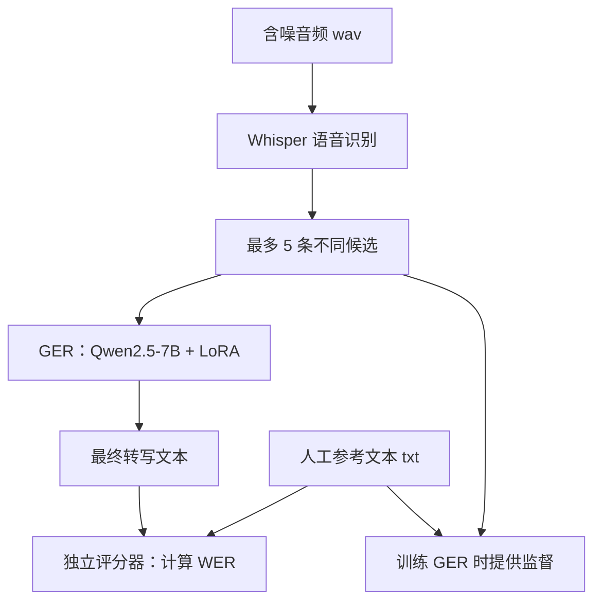
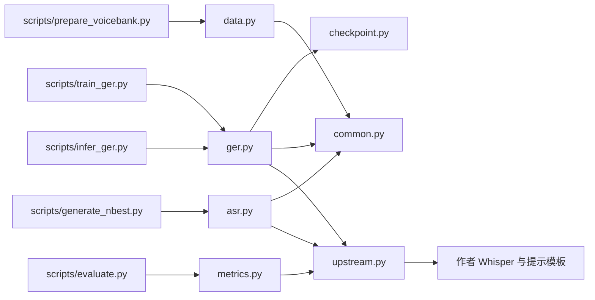

# 项目结构与代码学习指南

主体整理日期：2026-10-19；云端状态更新：2026-10-20。本文面向第一次复现论文的学习者，后文 Mac 环境与测试数量保留当时的记录。

云端位置：`/home/featurize/work/Vanilla-GER`；原 Mac 位置：`/Users/zguoxu/Documents/expriment/Vanilla GER`。

本项目复现 HyPoradise 的“语音识别候选 → 语言模型纠错”方法，并迁移到 VoiceBank-DEMAND。用户现已选用 Qwen2.5-7B 基础版替代原 LLaMA；云端真实7B小样本 CUDA 训练与重载已通过，15项软件测试通过，全量训练与最终测试尚待完成。当前命令和环境请读 [云端操作指南](Qwen与VoiceBank云端复现.md)，实际验收见 [云端起步验收](../reports/云端Qwen起步验收.md)。

## 1. 先理解整个项目在做什么



Whisper 负责把声音变成文字；GER 负责根据候选文字生成更好的转写。当前模型的最终输出是文字，评价指标是词错误率 WER。

几种常见叫法：

| 名称 | 在本项目中的含义 |
|---|---|
| ASR | Automatic Speech Recognition，自动语音识别，这里使用 Whisper |
| hypothesis | 模型给出的候选转写，可能包含错误 |
| 1-best / N-best | 第一条候选 / 按模型分数排列的多条候选 |
| reference | 人工正确转写，训练时作为答案，评分时作为比较依据 |
| GER | Generative Error Correction，生成式错误纠正 |
| base model | 预训练语言模型，正式实验使用固定版本的 LLaMA |
| LoRA adapter | 在冻结基座上训练的小量附加参数，需要配合相同基座使用 |
| checkpoint | 训练中保存的模型和训练状态，用于恢复或选择模型 |
| smoke test | 用少量样本检查流程能否工作，本身不代表正式效果 |
| train / dev / test | 训练集 / 用于调参与模型选择的验证集 / 最终评测集 |

## 2. 当前目录总览

下图列出维护的代码、配置和说明。大量重复的数据文件用命名模式表示，详细用途见第 6 节；作者仓库里的文件在第 8 节单独说明。

```text
Vanilla GER/
├── README.md                         项目入口与可执行命令
├── plan.md                           复现目标、阶段与验收标准
├── THIRD_PARTY.md                     作者源码来源和修改说明
├── pyproject.toml                    Python 项目与 pytest 配置
├── environment.yml                   Mac Conda 环境声明
├── .gitignore                        不纳入 Git 的路径规则
├── Chen 等 - 2023 - HyPoradise ...pdf  本地论文原文
├── configs/
│   ├── downloads.json                官方数据地址和校验信息
│   ├── splits.json                   数据划分记录
│   ├── asr-smoke.json                本地少量音频配置
│   └── asr-paper.json                云端目标 Whisper 配置
├── docs/
│   ├── 本地开发与Conda教程.md
│   └── 项目结构与代码学习指南.md       本文
├── requirements/
│   ├── macos.txt                     手动维护的主要依赖
│   ├── macos.lock.txt                实际安装的 pip 依赖快照
│   └── conda-osx-arm64.explicit.txt   当前平台的 Conda 包快照
├── scripts/                          从终端运行的入口
│   ├── check_env.py
│   ├── download_data.py
│   ├── fetch_upstream.py
│   ├── prepare_voicebank.py
│   ├── generate_nbest.py
│   ├── build_ger_data.py
│   ├── train_ger.py
│   ├── infer_ger.py
│   └── evaluate.py
├── src/
│   ├── vanilla_ger/                  可以被 import 的核心代码
│   │   ├── __init__.py
│   │   ├── common.py
│   │   ├── data.py
│   │   ├── upstream.py
│   │   ├── asr.py
│   │   ├── ger.py
│   │   ├── checkpoint.py
│   │   └── metrics.py
│   └── vanilla_ger.egg-info/          安装项目时生成的包信息
├── tests/
│   ├── test_pipeline.py              数据、评分及微型模型测试
│   └── test_checkpoint.py            断点恢复专项测试
├── data/                             原始数据与派生产物
│   ├── raw/
│   │   ├── archives/                 下载的两个 zip
│   │   └── voicebank_demand/
│   │       ├── noisy_trainset_28spk_wav/
│   │       ├── trainset_28spk_txt/
│   │       └── __MACOSX/             压缩包附带的 macOS 元数据
│   ├── manifests/                    完整样本清单
│   ├── audio_inputs/                 无标签 ASR 输入
│   ├── references/                   独立参考文本
│   ├── hypotheses/smoke-tiny/        10 条真实音频的候选和来源记录
│   └── ger/smoke/                    对应的 GER 训练及推理输入
├── reports/                          环境、数据和评测报告
├── patches/hypo2trans.patch          对作者固定版本的修改补丁
├── licenses/
│   ├── Hypo2Trans-MIT.txt
│   └── Whisper-MIT.txt
├── third_party/Hypo2Trans/           作者仓库的本地检出目录
├── .cache/                           模型权重和临时验证文件
├── .pytest_cache/                    pytest 自动生成的缓存
└── .git/                             当前项目的版本历史和远端配置
```

`outputs/` 是以后正式训练和推理产物的约定位置，目前尚未生成正式实验产物。`prompts/`、`data/processed/`、`prepare_audio.py` 曾出现在计划示意中，当前没有这些独立实现：提示模板复用作者文件，重采样在加载音频时完成。

## 3. 根目录、配置和环境文件

| 文件 | 作用 | 学习时怎样使用 |
|---|---|---|
| [README.md](../README.md) | 项目概览、环境检查和小样本运行命令 | 第一次开始时先看它，命令在项目根目录执行 |
| [plan.md](../plan.md) | 实验目标、论文参数、各阶段与完成标准 | 判断当前做到哪一步；其中待测内容不能当成实验结果 |
| [THIRD_PARTY.md](../THIRD_PARTY.md) | 作者仓库、固定 commit、许可证与修正差异 | 写复现报告或核对与论文的差异时阅读 |
| [pyproject.toml](../pyproject.toml) | 包名、Python 版本要求、构建方式、`src` 布局、pytest 测试目录 | 解释为什么能 `import vanilla_ger`；主要库依赖在 requirements 文件中 |
| [environment.yml](../environment.yml) | 创建 `vanilla-ger-mac`，安装 Python、FFmpeg、pip 依赖和本项目 | 新 Mac 重建环境时使用 |
| [.gitignore](../.gitignore) | 排除数据、权重、环境、缓存、论文 PDF 和作者检出目录等 | 首次提交 Git 前检查；被忽略的文件不会随 Git 自动同步 |
| 根目录论文 PDF | 论文原文，当前完整文件名为 `Chen 等 - 2023 - HyPoradise An Open Baseline for Generative Speech Recognition with Large Language Models.pdf` | 用来核对方法和参数，代码不会读取它 |
| [configs/downloads.json](../configs/downloads.json) | 两个训练数据压缩包的官方 URL、字节数与 MD5 | 下载器读取；这是下载的预期信息 |
| [configs/splits.json](../configs/splits.json) | 记录 28 个说话人和 dev 说话人 p226、p227 | `prepare_voicebank.py` 生成的划分记录；当前准备代码不会把手工编辑此文件当作输入 |
| [configs/asr-smoke.json](../configs/asr-smoke.json) | `tiny.en`、CPU、beam=5、最多 5 个候选、10 条数据 | 本地流程检查，可以传给 `generate_nbest.py --config` |
| [configs/asr-paper.json](../configs/asr-paper.json) | `large-v2`、CUDA、beam=60、最多 5 个候选 | 云端目标配置；显存和速度尚待实测，首次运行显式加 `--limit 10` |
| [requirements/macos.txt](../requirements/macos.txt) | 经过本地验证的主要依赖及固定版本 | 增加或改变项目主要依赖时维护它 |
| [requirements/macos.lock.txt](../requirements/macos.lock.txt) | 实际安装的 Python 包快照，含传递依赖 | 排查两台 Mac 的差异或恢复历史环境时参考 |
| [requirements/conda-osx-arm64.explicit.txt](../requirements/conda-osx-arm64.explicit.txt) | Conda 包的精确下载项，限定 macOS ARM64 | 同平台精确恢复时参考；云端 Linux 使用独立方案 |
| [docs/本地开发与Conda教程.md](本地开发与Conda教程.md) | 环境激活、编辑器解释器、数据使用和迁移步骤 | 对照终端操作 |
| [docs/项目结构与代码学习指南.md](项目结构与代码学习指南.md) | 当前目录、文件职责、数据流和阅读顺序 | 学代码时随时查阅 |
| [patches/hypo2trans.patch](../patches/hypo2trans.patch) | 对作者固定提交的源码修改差异 | `fetch_upstream.py` 用它恢复相同的修改结果 |
| [licenses/Hypo2Trans-MIT.txt](../licenses/Hypo2Trans-MIT.txt) | Hypo2Trans 的 MIT 许可原文 | 保留作者许可与署名 |
| [licenses/Whisper-MIT.txt](../licenses/Whisper-MIT.txt) | 作者仓库所含 Whisper 分支的 MIT 许可原文 | 同上 |

Conda 环境本体位于 `~/miniforge3/envs/vanilla-ger-mac/`，不在项目文件夹里。切换环境会改变终端使用的 Python 和库，项目源码仍保留在原目录。

## 4. scripts：从终端运行的入口

入口文件负责把终端参数传给程序。部分入口只有几行，是因为实际逻辑在 `src/vanilla_ger/` 中，方便多个脚本复用和测试。

| 文件 | 读取什么 | 完成什么、输出什么 |
|---|---|---|
| [check_env.py](../scripts/check_env.py) | 当前 Python、系统、库、FFmpeg 和设备信息 | 打印环境，并写 `reports/environment-macos.json`；Linux 则写 `environment-linux.json` |
| [download_data.py](../scripts/download_data.py) | `configs/downloads.json` | 支持断点下载，检查大小、MD5，记录 SHA-256；`--extract` 解压到原始数据目录；写 `reports/downloads.json` |
| [fetch_upstream.py](../scripts/fetch_upstream.py) | 官方仓库地址、固定 commit 和补丁 | 克隆作者仓库并应用补丁；已有相同结果会跳过，不兼容修改会报错 |
| [prepare_voicebank.py](../scripts/prepare_voicebank.py) | 原始音频和人工 txt | 调用 `data.main()`，按 ID 配对、划分 train/dev、生成三类清单和数据审计 |
| [generate_nbest.py](../scripts/generate_nbest.py) | `audio_inputs` 清单、ASR 配置、音频 | 调用 `asr.main()`，写候选 JSONL 和对应 `.meta.json` |
| [build_ger_data.py](../scripts/build_ger_data.py) | 候选和人工参考文本 | 按 ID 拼接，导出含答案的训练数据，以及不含答案的推理输入；支持 1-best 对照 |
| [train_ger.py](../scripts/train_ger.py) | 基座路径或模型 ID、train/dev 文件、训练参数 | 用 Fire 把命令参数交给 `ger.train()`；输出适配器、tokenizer、checkpoint 和训练元数据 |
| [infer_ger.py](../scripts/infer_ger.py) | 适配器目录、无标签 GER 输入 | 调用 `ger.inference_main()`，加载相同基座，写预测文本及推理元数据 |
| [evaluate.py](../scripts/evaluate.py) | 人工参考 + ASR 候选，或者人工参考 + GER 预测 | 计算 corpus WER，保存汇总 JSON 和逐句 `.details.jsonl`；ASR 模式还报告 N-best oracle |

`--allow-subset` 表示你明确只检查一个小子集。正式完整评测使用一致的 ID 集合，程序默认检查缺失和多余样本。

## 5. src/vanilla_ger：真正需要学习的核心代码

### 5.1 文件和关键函数

| 文件 | 关键内容 | 解决的问题 |
|---|---|---|
| [__init__.py](../src/vanilla_ger/__init__.py) | 包说明 | 标识这是 Python 包，没有训练逻辑 |
| [common.py](../src/vanilla_ger/common.py) | `ROOT`、`UPSTREAM`、`UPSTREAM_COMMIT`、`resolve_path()`、`read_records()`、`write_json()`、`write_jsonl()`、`sha256_file()` | 统一路径、文件读写、唯一 ID 检查和内容校验 |
| [data.py](../src/vanilla_ger/data.py) | `index_files()`、`prepare()`、`main()` | 找到音频/文本，按文件名配对，检查音频属性，固定划分，生成清单与审计 |
| [upstream.py](../src/vanilla_ger/upstream.py) | `whisper_module()`、`normalizer()`、`normalize_text()`、`prompter_class()` | 加载指定作者分支及提示模板，统一候选、标签和预测的文本规范化 |
| [asr.py](../src/vanilla_ger/asr.py) | `select_candidates()`、`generate()`、`main()` | 加载 Whisper，音频重采样，按模型分数排序并去重候选，检查缓存来源并断点继续 |
| [ger.py](../src/vanilla_ger/ger.py) | `prompt_for()`、`tokenize_record()`、`load_base()`、`generate_text()`、`GerTrainer`、`train()`、`inference_main()` | 构造提示、分词和 labels，加载基座，训练 LoRA，按 dev WER 选 checkpoint，重载推理 |
| [checkpoint.py](../src/vanilla_ger/checkpoint.py) | `CheckpointResumeMixin`、两个 `_load_*` 方法 | 为当前单设备训练路径明确指定断点加载方式，恢复优化器、调度器和随机数状态 |
| [metrics.py](../src/vanilla_ger/metrics.py) | `word_errors()`、`corpus_wer()`、`score_predictions()` | 编辑距离统计替换/删除/插入错误，严格按 ID 比较，计算整个数据集的 WER |

### 5.2 用你正在看的 data.py 练习阅读

按以下顺序阅读，不必从头逐行背代码：

1. 先看 `main()`：它接受原始数据目录和输出目录，调用 `prepare()`。
2. 看 `index_files()`：建立“文件 ID → 路径”的字典，排除 macOS 元数据，检查重复 ID。
3. 看 `prepare()` 前半部分：明确读取训练音频/文本文件夹，检查 ID 集合一致，确定 dev 说话人。
4. 看内部 `describe()`：为每条音频读取人工文本、采样率、声道、时长和哈希。
5. 看三个 `write_jsonl()`：同一批样本分别写成完整清单、参考文本、无标签输入。
6. 最后看审计：检查 train/dev 音频是否重复、文本是否重合，并保存数量和时长。

当前 `main()` 使用默认规则，按说话人 ID 排序取前两个作为 dev。程序还允许调用 `prepare(..., dev_speakers=[...])` 显式指定；要修改实验划分，需要改调用/配置接入并重新生成，单独编辑生成的 `splits.json` 不会改变程序行为。

### 5.3 核心调用关系



## 6. data：每类文件怎样使用

### 6.1 原始数据和固定划分

| 路径或文件模式 | 内容 | 怎样使用 |
|---|---|---|
| `raw/archives/noisy_trainset_28spk_wav.zip` | 官方训练含噪音频压缩包 | 下载校验后解压，训练不直接读取 zip |
| `raw/archives/trainset_28spk_txt.zip` | 官方训练人工转写压缩包 | 同上 |
| `raw/archives/noisy_testset_wav.zip`、`raw/archives/testset_txt.zip` | 官方测试音频和文本，已校验解压 | 独立用于测试候选生成和最终评分 |
| `raw/voicebank_demand/noisy_trainset_28spk_wav/pXXX_NNN.wav` | 11,572 条单声道、48 kHz 含噪音频 | Whisper 输入；加载时重采样到 16 kHz |
| `raw/voicebank_demand/trainset_28spk_txt/pXXX_NNN.txt` | 对应的 11,572 份人工文本 | 训练监督和离线评分 |
| `raw/voicebank_demand/clean_trainset_28spk_wav/pXXX_NNN.wav` | 对应的11,572条干净训练音频，已补充 | 按ID与noisy配对，可用于干净语音对照 |
| `raw/voicebank_demand/clean_testset_wav/pXXX_NNN.wav` | 对应的824条干净测试音频，已补充 | 同上，保持独立官方test划分 |
| `raw/voicebank_demand/__MACOSX/` 下的 `._*` | zip 附带的 macOS 文件属性 | 数据准备代码会排除，不作为文本标签 |
| `manifests/train.jsonl` | 10,830 条完整训练样本信息 | 数据检查与溯源，包含人工文本 |
| `manifests/dev.jsonl` | p226、p227 的 742 条完整样本信息 | 同上，用于验证集 |
| `manifests/test.jsonl` | p232、p257 的824条官方测试样本信息 | 独立保存，保持官方测试划分 |
| `audio_inputs/train.jsonl` | train 的 ID、音频路径、音频哈希 | ASR 候选生成入口读取 |
| `audio_inputs/dev.jsonl` | dev 的同类输入 | 同上 |
| `audio_inputs/test.jsonl` | test的ID、音频路径和哈希 | 独立生成测试候选，不含参考文本 |
| `references/train.jsonl` | train 的 ID、人工文本 | 拼接训练答案或离线评分 |
| `references/dev.jsonl` | dev 的 ID、人工文本 | 验证评分和 GER 验证标签 |
| `references/test.jsonl` | test的ID、人工文本 | 方案确定后的最终评分 |

这些路径均相对于 `data/`。`p226_001` 中，`p226` 是说话人 ID，`001` 是该文件的编号；同名 `.wav` 和 `.txt` 通过不含扩展名的 `utt_id` 对应。

2026-10-21云端更新：官方train/test的clean/noisy音频和人工文本均已补齐。dev从官方训练部分划出。三个划分没有ID、说话人和音频哈希交叉；规范化文本有train/dev 605种、train/test 617种、dev/test 183种重合，保留原始划分并如实记录。当前含噪ASR统一入口为 `scripts/prepare_full_asr.sh`；clean配对检查入口为 `scripts/check_clean_pairs.py`。详见 [三部分数据准备报告](../reports/VoiceBank三部分数据与ASR准备.md) 和 [clean下载验收](../reports/VoiceBank-clean下载验收.md)。

### 6.2 同一个 dev.jsonl，为什么有三份

以真实样本 `p226_001` 为例，下面只展示理解分工所需字段。

完整清单 `data/manifests/dev.jsonl`：

```json
{"utt_id":"p226_001","speaker_id":"p226","split":"dev","noisy_path":"data/raw/voicebank_demand/noisy_trainset_28spk_wav/p226_001.wav","ref_text":"Please call Stella.","sample_rate":48000,"channels":1,"duration_sec":2.28}
```

ASR 输入 `data/audio_inputs/dev.jsonl`：

```json
{"utt_id":"p226_001","noisy_path":"data/raw/voicebank_demand/noisy_trainset_28spk_wav/p226_001.wav","audio_sha256":"70b6473839e39ca8cb5f15261f9aa7a36dd2c21f6023e5b95747f77f9d36f4bb"}
```

评分参考 `data/references/dev.jsonl`：

```json
{"utt_id":"p226_001","ref_text":"Please call Stella."}
```

它们描述的是同一批样本的不同用途。推理入口使用不含人工答案的文件，评分器再按 ID 读取人工文本。

`JSON` 文件通常保存一个对象或数组；`JSONL` 文件每行保存一个完整 JSON 对象，因此适合逐条写入和断点继续。文件名相同，所在文件夹不同，其职责也不同。

### 6.3 已生成的候选和 GER 数据

| 路径 | 内容与用途 |
|---|---|
| `data/hypotheses/smoke-tiny/train.jsonl` | train 中 10 条真实音频的候选；每条保存 `utt_id`、`nbest`、原始候选及分数 `candidates`、`num_unique` |
| `data/hypotheses/smoke-tiny/train.meta.json` | 对应模型、权重校验值、上游 commit、解码代码哈希、输入哈希、配置和运行耗时；换配置时防止混用缓存 |
| `data/ger/smoke/train.json` | 10 条含 `utt_id/input1/input2/output` 的 GER 训练样例 |
| `data/ger/smoke/train-inputs.json` | 相同候选的无标签输入，只包含 `utt_id/input1/input2`，用于纠错推理 |

下列 GER 记录是说明格式的人造例子，不是模型运行结果：

```json
{
  "utt_id": "example_001",
  "input1": "please call stellar",
  "input2": "1. please call stella\n2. please call seller",
  "output": "please call stella"
}
```

`input1` 是第一条候选，`input2` 是其余候选按顺序拼接的文本，`output` 是参考答案。无标签推理文件去掉 `output`。

## 7. reports、tests 和自动生成文件

### 7.1 reports：结果记录

| 文件 | 记录什么 |
|---|---|
| [reports/本地配置验收.md](../reports/本地配置验收.md) | 已完成的数据、环境、源码和软件流程验收，以及尚未完成的云端工作 |
| [reports/environment-macos.json](../reports/environment-macos.json) | Python 实际路径、版本、库版本、MPS/CUDA 状态、FFmpeg 路径 |
| [reports/downloads.json](../reports/downloads.json) | 实际下载文件的官方校验值、SHA-256 和解压内容字节数 |
| [reports/data_audit.json](../reports/data_audit.json) | 实际样本数、说话人、采样率、时长、音频重复和文本重合检查 |
| [reports/asr-smoke.json](../reports/asr-smoke.json) | 10 条本地音频的 baseline WER、N-best oracle 和候选不足 5 条的数量 |
| `reports/asr-smoke.json.details.jsonl` | 对应逐句 reference、prediction、S/D/I 和参考词数，被 Git 忽略 |

`configs/` 主要保存预期设置，`reports/` 主要保存实际发生的结果。下载器也体现了这个区别：配置写预期 MD5，报告记录完成校验后的文件信息。

本地 `tiny.en` 的 10 条数据 WER 为 95.74%，只用于软件流程和坏例分析；它不能代替正式 `large-v2` 基线或论文效果。

### 7.2 tests：检查代码是否可信

| 文件 | 覆盖内容 |
|---|---|
| [tests/test_pipeline.py](../tests/test_pipeline.py) | 7 项：corpus WER 与 ID、模板无答案泄漏、候选去重/数字、数据配对/划分、GER 导出、loss mask/截断、随机微型 LLaMA 的实际 LoRA 更新及保存/重载/续训 |
| [tests/test_checkpoint.py](../tests/test_checkpoint.py) | 3 个测试用例：恢复后下一次参数更新、学习率及随机数序列一致；优化器与 RNG 两种文件中的未许可对象均被拒绝，临时类型许可没有残留 |

测试里的微型 LLaMA 是随机初始化的本地小模型，用来验证软件行为，不是正式的 7B/13B 模型。测试用临时目录由 pytest 管理，不会产生一套正式实验结果。

### 7.3 缓存和工具文件

| 目录或文件 | 作用、是否手工编辑 |
|---|---|
| `.cache/whisper/tiny.en.pt` | 已下载的轻量 Whisper 权重，程序自动加载；不手工编辑 |
| `.cache/fixture-input.jsonl` | 前期用作者 JFK 测试音频检查解码时的输入清单 |
| `.cache/fixture-hypotheses.jsonl` | 上述音频的候选结果，独立于 VoiceBank 实验 |
| `.cache/fixture-hypotheses.meta.json` | 上述结果的模型/配置来源记录 |
| `.cache/download_parts/` | 下载器使用的分块工作目录；已完成文件的分块会清理，父目录可能保留 |
| `.pytest_cache/.gitignore`、`CACHEDIR.TAG`、`README.md` | pytest 缓存目录的工具说明与标记 |
| `.pytest_cache/v/cache/nodeids` | pytest 收集到的测试 ID，工具自动维护 |
| `.pytest_cache/v/cache/lastfailed` | 上次失败用例的缓存；不代表本次仍然失败，以当前测试结果为准 |
| `.pytest_cache/v/cache/stepwise` | pytest 逐步执行模式的状态 |
| 各目录中的 `__pycache__/*.pyc` | Python 自动生成的字节码缓存，不手工编辑 |
| 各目录中的 `.DS_Store` | macOS 文件夹显示信息，和模型训练无关 |
| `src/vanilla_ger.egg-info/PKG-INFO` | 本项目安装后的名称、版本等包信息 |
| `src/vanilla_ger.egg-info/SOURCES.txt` | Python 构建工具记录的源文件清单 |
| `src/vanilla_ger.egg-info/dependency_links.txt` | 构建工具生成的旧式依赖链接信息，当前通常为空 |
| `src/vanilla_ger.egg-info/top_level.txt` | 顶层导入包名 `vanilla_ger` |
| `.git/` | 外层项目的版本对象、索引、HEAD、远端等；使用 Git 命令管理 |
| 工作区上一级的 `../.vscode/settings.json` | 编辑器工作区配置，目前设置默认环境/包管理器为 Conda；它不等于每个终端已经激活环境 |

这些自动生成文件不需要作为代码来学习。数据、模型、训练结果和源码的备份方式应分别管理；`.gitignore` 排除的数据不会被 `git clone` 下载。

## 8. third_party/Hypo2Trans：作者源码文件说明

固定提交：`27824d9da316b34855157dd9f6b80ea47119e804`。这个目录包含作者代码和项目补丁后的结果；外层 Git 通过固定 commit、补丁和恢复脚本重建它。

下列路径全部相对于 `third_party/Hypo2Trans/`。本项目的常用命令从外层 `scripts/` 运行。作者历史依赖文件主要用于查阅，其依赖范围大于本项目验证过的 Mac 环境。

### 8.1 作者仓库根目录与 H2T-LoRA

| 文件 | 作用 |
|---|---|
| `README.md` | 作者方法介绍、数据和训练使用说明 |
| `LICENSE` | 作者仓库 MIT 许可 |
| `requirements.txt` | 作者原有大范围环境依赖快照，包含其其他工具和历史依赖 |
| `H2T_LoRA` | 仅含简短说明文字的文件，不是可执行模型或训练脚本 |
| `HP_dataset_legal agreement.pdf` | 作者提供的 HyPoradise 数据使用协议文档；当前 VoiceBank 文件下载不读取它 |
| `image-H2T.png` | 作者 README 使用的模型方法示意图 |
| `is-24-call.odt` | 作者仓库附带的办公文档，训练和推理代码不使用 |
| `H2T-LoRA/README.md` | 作者 LoRA 训练和推理说明，示例参数可能与论文设置不同 |
| `H2T-LoRA/finetune.py` | 已修正为转调外层 `vanilla_ger.ger.train` 的兼容入口 |
| `H2T-LoRA/inference.py` | 已修正为转调外层 `vanilla_ger.ger.inference_main` 的兼容入口 |
| `H2T-LoRA/templates/H2T-LoRA.json` | 本项目实际使用的 N-best/1-best 提示模板和回答分隔符 |
| `H2T-LoRA/utils/__init__.py` | 标识作者工具包 |
| `H2T-LoRA/utils/README.md` | 作者工具目录说明 |
| `H2T-LoRA/utils/prompter.py` | 读取模板并填入 best/others，处理回答分隔符；已修正路径和 1-best 占位符 |
| `H2T-LoRA/utils/callbacks.py` | 作者的流式生成回调与迭代器工具，当前项目普通推理入口不调用 |

### 8.2 generate_data 与 Whisper 外层文件

| 文件 | 作用 |
|---|---|
| `generate_data/README.md` | 作者候选数据生成说明 |
| `generate_data/requirements.txt` | 作者当时的数据生成环境依赖 |
| `generate_data/whisper/LICENSE` | Whisper 分支的 MIT 许可 |
| `generate_data/whisper/model-card.md` | Whisper 的模型说明、用途与限制 |
| `generate_data/whisper/requirements.txt` | Whisper 分支自身的历史依赖 |
| `generate_data/whisper/setup.py` | 将作者 Whisper 分支作为 Python 包安装的构建说明 |
| `generate_data/whisper/MANIFEST.in` | 构建分发包时包含哪些资源文件 |
| `generate_data/whisper/generate_hp_dataset.py` | 原来的候选生成入口，已修正为转调外层 `vanilla_ger.asr.main` |
| `generate_data/whisper/compute_wer.py` | 作者附带的旧评分脚本，读取固定 `hyp.txt/ref.txt`；本项目统一使用外层评分入口 |
| `generate_data/whisper/notebooks/LibriSpeech.ipynb` | LibriSpeech 使用示例 notebook，不是 VoiceBank 的当前入口 |
| `generate_data/whisper/notebooks/Multilingual_ASR.ipynb` | 多语言识别示例 notebook，不是当前英文实验入口 |

### 8.3 Whisper 模型实现

下面路径统一加前缀 `generate_data/whisper/whisper/`。

| 文件 | 作用 |
|---|---|
| `__init__.py` | 模型名称、下载地址、校验和 `load_model()`；已添加明确的 `large-v2` 条目 |
| `__main__.py` | `python -m whisper` 的命令行入口，转给 transcribe 的 CLI |
| `audio.py` | FFmpeg 加载和重采样、补齐/裁剪、Mel 频谱计算 |
| `model.py` | Whisper 编码器、解码器及 Transformer 网络结构 |
| `decoding.py` | token 解码和 beam search；已修正为可返回带分数的实际候选列表 |
| `tokenizer.py` | 文本与 token ID 的转换、特殊 token、语言/任务 token |
| `transcribe.py` | 较高层的完整转写流程、分段和 CLI；当前候选生成直接调用 decode |
| `utils.py` | Whisper 辅助函数，例如输出格式和时间戳等 |
| `normalizers/__init__.py` | 文本规范化工具的导出入口 |
| `normalizers/basic.py` | 基础文本规范化处理 |
| `normalizers/english.py` | 英文拼写、缩写、数字等规范化逻辑 |
| `normalizers/english.json` | 英文规范化使用的拼写映射资源 |

### 8.4 Whisper tokenizer 与音频资源

下面路径统一加前缀 `generate_data/whisper/whisper/assets/`。

| 文件 | 作用 |
|---|---|
| `mel_filters.npz` | 音频转换为 Mel 频谱时使用的滤波器矩阵 |
| `gpt2/vocab.json` | 英文 tokenizer 的词表/token ID 映射 |
| `gpt2/merges.txt` | 英文 tokenizer 的 BPE 合并规则 |
| `gpt2/special_tokens_map.json` | 英文 tokenizer 的特殊 token 映射 |
| `gpt2/tokenizer_config.json` | 英文 tokenizer 配置 |
| `multilingual/vocab.json` | 多语言 tokenizer 的词表/token ID 映射 |
| `multilingual/merges.txt` | 多语言 tokenizer 的 BPE 合并规则 |
| `multilingual/special_tokens_map.json` | 多语言 tokenizer 的特殊 token 映射 |
| `multilingual/tokenizer_config.json` | 多语言 tokenizer 配置 |
| `multilingual/added_tokens.json` | 多语言 tokenizer 补充的 token 定义 |

这些资源需要随代码保留，正常使用时不手动修改。

### 8.5 作者测试和安装元数据

下面路径统一加前缀 `generate_data/whisper/`。

| 文件 | 作用 |
|---|---|
| `tests/jfk.flac` | 作者 Whisper 的固定测试音频，前期曾用于检查模型解码 |
| `tests/test_audio.py` | 音频加载、频谱等测试 |
| `tests/test_normalizer.py` | 文本规范化测试 |
| `tests/test_tokenizer.py` | tokenizer 行为测试 |
| `tests/test_transcribe.py` | 转写相关测试，可能需要模型等额外资源 |
| `whisper.egg-info/PKG-INFO` | Whisper 包信息 |
| `whisper.egg-info/SOURCES.txt` | Whisper 分发源文件清单 |
| `whisper.egg-info/dependency_links.txt` | 旧式依赖链接元数据 |
| `whisper.egg-info/entry_points.txt` | 安装后的命令行入口定义 |
| `whisper.egg-info/requires.txt` | Whisper 包依赖元数据 |
| `whisper.egg-info/top_level.txt` | 顶层包名信息 |

作者目录中的 `.git/` 属于作者仓库自己的版本信息；`.DS_Store`、`__pycache__/` 与外层同类文件一样是工具产物。

外层的 `python -m pytest -q` 由 `pyproject.toml` 指定只收集本项目 `tests/`，因此当前“10 项通过”不表示作者仓库所有测试也已运行。

## 9. 本次两条 FutureWarning 的原因与修正

你原来的输出 `7 passed, 2 warnings` 表示全部测试通过，另外出现两条兼容性提醒。终端前面的 `(vanilla-ger-mac)` 也表明你当时已激活项目环境。

两条提醒均来自固定版本 Transformers 4.46.3 的 Trainer，在断点恢复时调用 `torch.load()` 没有显式设置 `weights_only`：

| 读取对象 | 内容 | 修正方式 |
|---|---|---|
| `optimizer.pt` | AdamW 的动量、步数等状态 | 显式 `weights_only=True` 并先加载到 CPU |
| `scheduler.pt` | 学习率调度状态 | 同样显式设置，保持恢复后的学习率进度 |
| `rng_state.pth` | Python、NumPy、PyTorch 的随机数状态，GPU 训练时还含 CUDA 状态 | `weights_only=True`，只在本次读取期间许可 NumPy RNG 所需的数组/类型构造对象 |

之所以不只在所有位置机械加上一个参数，是因为 NumPy 随机数状态包含数组及 dtype，受限加载还需要明确许可这些类型。相关方式见 [PyTorch 序列化说明](https://github.com/pytorch/docs/blob/site/stable/notes/serialization.md)。

实现位置是 `src/vanilla_ger/checkpoint.py`；`GerTrainer` 继承该恢复逻辑。没有修改 Conda 环境中安装的第三方源码，没有通过过滤规则隐藏警告，也没有改变依赖版本。临时许可在读取结束后退出，遇到未许可对象会报错，不会退回普通 pickle 加载。

当前实现限定项目既有的单设备 CPU/MPS/CUDA 训练路径；本次实际验证的是 CPU，CUDA 与量化训练仍待上云测试。断点文件继续使用 Trainer 的原格式。

修正后实际执行：

```bash
python -m pytest -q -W error::FutureWarning
```

结果：**10 passed in 5.63s**，没有这两条警告。这里的 `-W error::FutureWarning` 会把此类警告升级为错误，便于确认修正有效；平时可继续执行 `python -m pytest -q`。

`python scripts/check_env.py` 和 `python -m pip check` 也已执行，解释器及 FFmpeg 均来自项目环境，依赖检查通过。

## 10. 推荐阅读顺序与动手任务

按数据流阅读，每次理解一个模块：

1. **环境与路径**：先读 README、Conda 教程，再读 `common.py`。弄清项目根目录、Conda 环境、相对路径分别是什么。
2. **数据**：读 `scripts/prepare_voicebank.py → data.py`，用 `p226_001` 找到三份清单中的同一条记录。
3. **评分**：读 `metrics.py → scripts/evaluate.py`，手算一个例子：参考 `hello world`，预测 `hello`，删除 1 个词，WER=50%。
4. **语音识别**：读 `scripts/generate_nbest.py → asr.py → upstream.py`，观察一条候选记录的分数、去重和来源文件。
5. **训练数据**：读 `scripts/build_ger_data.py`，对比 `train.json` 与 `train-inputs.json`，确认答案只出现在哪一份。
6. **纠错训练**：读 `ger.py` 的 prompt、tokenization、LoRA 配置、训练及推理，再看模板 JSON。
7. **保存与恢复**：读 `checkpoint.py` 和两个测试文件，理解为什么恢复训练需要参数以外的状态。
8. **原理深入**：需要理解 Whisper 网络或 beam search 时，再进入作者的 `model.py` 和 `decoding.py`。

开始一次本地学习时：

```bash
source "$HOME/miniforge3/etc/profile.d/conda.sh"
conda activate vanilla-ger-mac
cd "/Users/zguoxu/Documents/expriment/Vanilla GER"
python scripts/check_env.py
python -m pytest -q
```

接下来按 README 跑 10 条候选、评分和 GER 数据导出。已经完成且配置一致的候选会直接复用；想重新生成时使用新的输出目录。理解这些输入与输出之后，就可以准备第一次云端小样本 GPU 验证。
