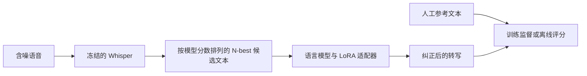

# HyPoradise 在 VoiceBank-DEMAND 上的分步复现计划

更新时间：2026-10-20

云端项目目录：`/home/featurize/work/Vanilla-GER`（原 Mac 目录：`/Users/zguoxu/Documents/expriment/Vanilla GER`）
项目仓库：[Zguoxu/Vanilla-GER](https://github.com/Zguoxu/Vanilla-GER)  
面向对象：第一次复现论文的学习者。  
开发方式：先在 Mac 编写代码并做小样本检查，通过 Git 同步到云端；每完成一个需要 GPU 的模块就上云验证，无需等全部代码写完。云端 RTX 3090 练手，后续根据实测考虑 RTX 4090、RTX 5090 或 A100。

> 本文包含总体计划、本地历史进度和云端验收。当前已完成真实 Qwen 7B 的小样本 CUDA 训练闭环；全量正式训练和最终测试结果仍待验证。

## 2026-10-20 云端方案更新

用户已确认使用 **Qwen/Qwen2.5-7B 基础版**替代原论文第一代 LLaMA。固定 revision 为 `d149729398750b98c0af14eb82c78cfe92750796`，训练配置见 `configs/ger-qwen2.5-7b.json`，练手配置见 `configs/ger-qwen2.5-7b-smoke.json`。

当前主线为：**VoiceBank-DEMAND 含噪音频 → 冻结的 Whisper large-v2（beam=60，去重后最多5条候选）→ Qwen2.5-7B 的 8-bit 基座 + LoRA → 文本及 WER**。模型家族、规模、数据集均有迁移差异，结果记录为方法复现与迁移实验。4-bit 为独立变体。先用 tiny.en 的独立缓存验收小样本，再验证正式 ASR 设置。

云端已建立独立 ASR/训练环境；Qwen/Whisper 权重及哈希、11,572条训练部分数据、固定 train/dev 划分均已核验。15项软件测试通过，包含GPU上的INT8 LoRA更新。真实 Qwen 7B 已用32条 train、4条 dev 完成8次参数更新，退出后重载预测一致；该小样本 WER 未改善，只用于流程验收。

large-v2/beam=60 已完成10条 dev 测速与评分。修正上游交叉注意力缓存的重复计算后，同批候选及分数完全一致，3090 解码耗时由17.60降至8.53秒/条，按11,572条外推约27.4小时。4090 尚未实测。详见 [云端起步验收](reports/云端Qwen起步验收.md) 和 [云端操作指南](docs/Qwen与VoiceBank云端复现.md)。全量候选脚本已准备，尚未启动。

后续更新：官方测试音频与文本已下载并通过官方MD5；独立test为824条（p232/p257），现有train/dev的6份输入和参考清单内容未变。统一入口 `scripts/prepare_full_asr.sh` 已扩展到train/dev/test，并提供 `--dry-run` 和 `--limit 1`。三部分各1条实际解码已通过，共12,396条的全量候选仍未启动。按原10条速度外推约29.4小时，仅供预算参考。详见 [三部分数据与ASR准备](reports/VoiceBank三部分数据与ASR准备.md)。

2026-10-21补充：clean训练及测试音频也已下载，按ID配对检查见 [clean下载验收](reports/VoiceBank-clean下载验收.md)。clean用于后续对照，当前含噪音频的ASR输入与划分保持原有配置。

## Mac 历史进度：2026-10-19

- [x] 下载并通过官方 MD5 校验的 28-speaker 训练含噪音频、人工文本已解压到 `data/raw/voicebank_demand/`。
- [x] 扫描 11,572 条样本；固定为 train 10,830 条、dev 742 条，dev 说话人为 p226、p227。
- [x] 拉取固定版本官方源码，保存修正补丁及许可；本地软件测试 10 项通过，断点加载的两条 FutureWarning 已修正。
- [x] 安装 Miniforge 并创建 `vanilla-ger-mac`，保存环境依赖与完整版本快照。
- [x] 用 `tiny.en/beam=5/CPU` 跑通 10 条真实训练音频的候选、评分和 GER 格式导出。
- [ ] 云端 CUDA/量化验证、正式 large-v2 候选生成、真实 LLaMA 训练和官方 test 评测。

原计划引用的 `docs/本地开发与Conda教程.md` 在当前仓库及本地 Git 历史中未找到。云端现在按 [Qwen 与 VoiceBank 操作指南](docs/Qwen与VoiceBank云端复现.md) 执行；原 Mac 结果见 [本地配置验收](reports/本地配置验收.md)。下文各阶段清单描述完整目标，不能将少量 smoke 检查等同于正式实验完成。

## 1. 先明确我们要复现什么

论文是 **HyPoradise: An Open Baseline for Generative Speech Recognition with Large Language Models**，NeurIPS 2023。以下以你提供的 PDF 为主要依据：`arXiv:2309.15701v2，2023-10-16`，重点参考第 3、4、5 节和第 18–20 页附录。[论文入口](https://arxiv.org/abs/2309.15701)

论文的方法先让语音识别模型给出多个候选句子，再让语言模型根据这些候选句子生成正确转写。这种方法叫 **GER：Generative Error Correction，生成式错误纠正**。



人工参考文本只在训练和离线评分时使用，不能出现在测试时的模型输入里。这个项目的主要输出是**文本**，主要指标是 **WER，词错误率**。现阶段不训练从含噪波形生成干净波形的语音增强网络。

### 1.1 数据集变化意味着什么

原论文评测使用了 LibriSpeech、CHiME-4、WSJ 等数据，**没有 VoiceBank-DEMAND**。因此，本项目的目标定义为：

**复现 HyPoradise 的 H2T-LoRA 方法，在 VoiceBank-DEMAND 上重新构建候选文本数据，并验证 GER 是否改善含噪语音识别。**

这属于“方法复现与新数据集上的迁移实验”。我们会遵循论文的核心流程，但不能要求 VoiceBank-DEMAND 的 WER 等于论文原表中的数值，也不能预先保证纠错一定带来提升。报告中必须列明数据集、模型、解码、划分和精度方面的差异。

### 1.2 本轮的范围与完成标准

论文包含提示学习、全参数微调 H2T-ft、LoRA 微调 H2T-LoRA。第一次实践先完成 **H2T-LoRA 主线**，随后再扩展其他方法。

完成标准依次是：

1. 能解释一条音频如何对应参考文本、候选文本和训练样本。
2. 能得到可信的 Whisper 基线 WER，以及 N-best oracle WER。
3. 能用几十条训练样本跑通 LoRA 训练、保存、重新加载和推理。
4. 能在固定的数据划分上完成正式训练，并在冻结方案后评测测试集。
5. 能通过相同条件下的对照，判断改善来自训练、多个候选，还是其他改动。
6. 能用代码版本、配置、数据清单和日志重新运行实验；改善不明显或变差也如实报告。

### 1.3 需要掌握的几个词

| 名词 | 在本项目中的意思 |
| --- | --- |
| ASR | Automatic Speech Recognition，把音频转成文字 |
| reference / ground truth | 数据集提供的人工参考文本，用来监督和评分 |
| hypothesis | ASR 猜出的一个候选句子 |
| 1-best | ASR 模型分数最高的候选；并不一定是最正确的句子 |
| N-best | 同一段音频的多个候选，正式目标是取去重后的前 5 条 |
| LoRA | 冻结语言模型主体，只训练少量新增参数 |
| train / dev / test | 训练集学参数，验证集选方案，测试集评估最终方案 |
| checkpoint | 保存的模型训练状态或适配器权重 |

## 2. 对齐论文设置，避免把练手版本当作原设定

你提供的 PDF 第 4、7、18、20 页给出了主方法设置。官方仓库的 README 和脚本存在差异，不能直接复制一条命令就宣称复现成功。

官方代码来源：[Hypotheses-Paradise/Hypo2Trans](https://github.com/Hypotheses-Paradise/Hypo2Trans)。本次检查的提交为 `27824d9da316b34855157dd9f6b80ea47119e804`；实施时保存该提交及我们所做的修改。

2026-10-19 再次核验：仓库可访问，默认分支为 `main`，代码许可证为 MIT，当前提交与上述记录一致。主要代码入口如下：

| 入口 | 用途 |
| --- | --- |
| [H2T-LoRA/finetune.py](https://github.com/Hypotheses-Paradise/Hypo2Trans/blob/27824d9da316b34855157dd9f6b80ea47119e804/H2T-LoRA/finetune.py) | 冻结 LLaMA 基座，训练 LoRA 纠错模型 |
| [H2T-LoRA/inference.py](https://github.com/Hypotheses-Paradise/Hypo2Trans/blob/27824d9da316b34855157dd9f6b80ea47119e804/H2T-LoRA/inference.py) | 加载适配器并生成纠错结果 |
| [generate_data/whisper/generate_hp_dataset.py](https://github.com/Hypotheses-Paradise/Hypo2Trans/blob/27824d9da316b34855157dd9f6b80ea47119e804/generate_data/whisper/generate_hp_dataset.py) | 调用仓库中的 Whisper 分支，生成 N-best 候选数据 |
| [H2T-LoRA/templates/H2T-LoRA.json](https://github.com/Hypotheses-Paradise/Hypo2Trans/blob/27824d9da316b34855157dd9f6b80ea47119e804/H2T-LoRA/templates/H2T-LoRA.json) | 1-best / N-best 提示模板 |

已确认的主要公开实现是 H2T-LoRA 和 Whisper 候选生成；不据此假定论文每一项实验都有完整可运行脚本。官方仓库已拉取到 `third_party/Hypo2Trans/`，已新增 VoiceBank-DEMAND 的读取、ID 对齐、划分和格式转换。修正说明见 [THIRD_PARTY.md](THIRD_PARTY.md)，实际改动保存在 `patches/hypo2trans.patch`，可通过脚本重建。

| 项目 | 论文中的主要设置 | 本项目安排 |
| --- | --- | --- |
| 训练任务 | 候选文本列表 → 参考文本 | 保持一致，训练 GER 时冻结 ASR |
| ASR | Whisper-Large，附录明确 large-v2 | 练手已用 `tiny.en`；正式用明确版本 `large-v2`，不使用含义可能变化的 `large` 别名 |
| 候选生成 | beam size 60，去重后取前 5 条 | 正式对齐；练手先减小 beam，并使用独立缓存 |
| 纠错主模型 | 原始 LLaMA-13B，即 LLaMA 第一代 | 用户已选 Qwen2.5-7B 基础版；固定来源及 revision，明确记录替代基座与规模差异 |
| LoRA rank | LLaMA 的 `r=8` | 主实验对齐；仓库 README 的 `r=16` 不能误当论文值 |
| 学习率 | `1e-4` | 作为主实验起点，只用 dev 决定调整 |
| 有效 batch size | 128 | 用小 micro batch 和梯度累积实现 |
| epoch / 优化器 | 10 / AdamW | 初始上限 10 轮，用 dev 选择 checkpoint |
| LoRA 注入位置 | 公开代码使用 q/k/v/o 投影 | 记录 `q_proj,k_proj,v_proj,o_proj`；alpha=16、dropout=0.05 来自所检查代码，属于实现补充 |
| 精度 | 附录没有完整说明 | 所检查代码为 8-bit 基座 + LoRA；先沿用，4-bit QLoRA 另作节省显存的变体 |
| 验证划分 | 附录微调部分提到从训练数据中留出 5% | 本项目优先按说话人留出 dev，属于明确的迁移改动 |
| 指标 | WER，论文使用 Sclite | 项目主报告 corpus WER；用 Sclite 交叉核验评分实现 |

**模型名称不能混用。** LLaMA-1、Llama 2、Llama 3 和其他模型属于不同基座。若原始权重无法获取，先记录原因，再选择替代路线；替代实验可以有价值，但不能标为原模型复现。论文的历史权重链接为 [decapoda-research/llama-13b-hf](https://huggingface.co/decapoda-research/llama-13b-hf)，是否可获取、分词器是否匹配，需要在模型准备阶段实际核验。

## 3. 云 GPU 路线：先在 3090 上证明流程正确

| 设备 | 标准显存 | 在本计划中的用途 |
| --- | --- | --- |
| RTX 3090 | 24 GB | 第一阶段主力：小规模 ASR、7B 量化 LoRA、推理与排错 |
| RTX 4090 | 24 GB | 流程稳定后测吞吐；与 3090 显存相同，不能据此假定可运行更大模型 |
| RTX 5090 | 32 GB | 需要更大显存时的候选；迁移时重新核验 CUDA、PyTorch 和量化依赖 |
| A100 | 常见有 40 GB、80 GB 版本 | 13B 或较大解码显存需求的候选；云实例须确认实际可用显存及是否为切分实例 |

显存规格依据：[3090](https://www.nvidia.com/en-eu/geforce/graphics-cards/30-series/rtx-3090/)、[4090](https://www.nvidia.com/en-us/geforce/graphics-cards/40-series/rtx-4090/)、[5090](https://www.nvidia.com/en-gb/geforce/graphics-cards/50-series/rtx-5090/)、[A100](https://www.nvidia.com/en-us/data-center/a100/)。上述用途是本项目的安排，能否运行以实测为准。

执行顺序：

1. 在 3090 上用 10–20 条音频测试 ASR，用 32–64 条训练样本测试 GER。
2. ASR 与 GER 分进程、分阶段运行。候选文本保存后，训练时不必再加载 Whisper。
3. 用正式设置的小批样本测峰值显存、秒/条、训练步耗时，再决定是否扩容。
4. 先完成已选 Qwen2.5-7B 的加载、训练更新和生成；更大模型作为后续独立扩展。
5. 发生 OOM 时先减小 micro batch、检查序列长度、启用梯度检查点。降低正式 beam、换模型或改量化精度属于实验设置变化，必须单独记录。

13B 的 FP16 权重本身约需 26 GB 十进制存储量，训练还需要激活、适配器梯度及优化器等额外空间。8-bit/4-bit 能减少基座占用，但不能由权重大小直接推断训练显存。Whisper 在 beam=60 下的需求也不能套用普通单候选推理的显存估计。

不预先承诺训练耗时或云费用。先测一小批，估算完整数据解码、训练与评测的总时长，确认值得运行后再扩大规模。更换 GPU 时保存新环境，重新做一次小样本检查。

## 4. VoiceBank-DEMAND 应该怎样使用

### 4.1 使用发布好的 28-speaker 版本

从 [爱丁堡大学官方数据页](https://datashare.ed.ac.uk/items/6ed35425-bf14-4d2b-93a1-0a4984952757) 获取数据，持久标识符为 [10.7488/ds/2117](https://doi.org/10.7488/ds/2117)。它包含配对的 clean/noisy 音频，以及单独的文本压缩包，原始音频为 48 kHz。

第一版使用 **28-speaker train + 官方 test**，不混入 56-speaker 训练版本，也不需要自行重新从 DEMAND 合成噪声。

| 要下载的文件 | 用途 |
| --- | --- |
| `noisy_trainset_28spk_wav.zip` | 生成 train/dev 的 ASR 候选 |
| `trainset_28spk_txt.zip` | train/dev 的人工参考文本 |
| `noisy_testset_wav.zip` | 生成最终测试候选 |
| `testset_txt.zip` | 最终测试评分所需的参考文本 |
| `clean_trainset_28spk_wav.zip` | 配对完整性检查、可选诊断，不作为 GER 输入 |
| `clean_testset_wav.zip` | 可选的干净语音 ASR 对照 |
| `logfiles.zip` | 查看发布说明及噪声等元数据 |

四个音频压缩包合计约 5.3 GB；还要为解压、重采样、模型和训练产物单独留空间。发布时保留数据来源与使用条款，Git 仅管理项目代码和必要的清单，不上传原始音频或模型权重。

### 4.2 一条样本的对应关系

以下仅为格式示意，文本不是实际数据标签：

```text
noisy_trainset_28spk_wav/pXXX_001.wav   含噪音频
clean_trainset_28spk_wav/pXXX_001.wav   同一句话的干净音频
trainset_28spk_txt/pXXX_001.txt         人工参考文本
```

通过文件名中的 utterance ID 对齐，不能依靠文件夹遍历顺序。必须检查实际压缩包结构，再编写读取程序。

在本项目中，每一项的作用是：

```text
含噪音频 → Whisper → 候选文本列表
候选文本列表 + 人工参考文本 → GER 训练样本
测试候选文本列表 → 训练好的 GER → 预测文本
预测文本 + 人工参考文本 → 离线计算 WER
```

干净音频不能替代人工参考文本；用 Whisper 识别干净音频得到的文字也不能冒充 ground truth。

### 4.3 固定划分，再做模型实验

1. 完整保留官方测试集。训练、超参数选择和 few-shot 示例选择都不用测试集。
2. 扫描官方训练集的 speaker ID，按字典序固定取前 2 个说话人作为 dev，其余 26 个用于 train。将实际 ID 写入 `configs/splits.json`，之后锁定。
3. 这项 26/2 的 train/dev 划分由本项目制定，不是数据发布方提供的独立验证集。
4. smoke 子集只从 train/dev 取，不把测试集当作调试集。
5. 检查不同 split 的 utterance ID、音频哈希和说话人是否交叉。另统计规范化参考文本的重合情况：不同说话人可能朗读相同句子，按说话人划分不代表文本也完全不同。
6. 记录各 split 的实际条数、时长和文本重合比例。常用 28-speaker 发布版本的数量校验参考为训练部分 11,572 条、测试部分 824 条；以解压后的逐项核验为准，差异必须查明。

## 5. 分阶段执行，每一步都有验收标准

按顺序推进。每个阶段完成后先检查产物，再进入下一阶段；不要求第一次就理解所有训练代码。

### 阶段 0：理解输入输出，先准备本地项目

**目的：** 在 Mac 上建立可检查、可同步的项目；需要 GPU 的验证安排在首次上云时进行。

待做事项：

- [ ] 能用自己的话解释上面的数据流程，并指出参考文本在哪一步可用。
- [ ] 先在本地项目中整理官方代码来源与配置；Mac 路径有空格，终端中始终给完整路径加引号。
- [ ] 为本地项目建立独立 Python 环境，记录版本；先安装数据处理和检查所需的依赖。
- [ ] 分别记录本地 macOS 与云端 Linux 的依赖方案，不把 Mac 环境目录直接复制到云端。
- [ ] 规划 ASR 与 GER 的独立环境，避免旧版 Whisper 分支和训练依赖相互干扰。
- [ ] 先安装完成当前阶段所需的最小依赖，验证后锁版本；不直接安装官方仓库整份庞大的 `requirements.txt`。
- [ ] 创建 `.gitignore`，排除数据、缓存、权重、环境目录、凭据和 `.DS_Store`；配置和日志摘要保留在项目中。
- [ ] 保存环境清单及官方代码 commit，明确训练基座的获取条件。

当前本地仓库已设置 `origin`，项目代码与官方源码已就位；独立环境 `vanilla-ger-mac` 使用 Python 3.10.22、PyTorch 2.5.1。云端 Linux/CUDA 仍需建立并验证单独的环境。

**产物：** `reports/environment-macos.json`、验证过的依赖锁定文件、`.gitignore`、Conda 操作教程。

**本地验收：** 数据处理代码能在小样本上执行，环境可通过记录重建，代码与配置可以通过 Git 同步。

**首次上云时补验：** 检查 GPU、实际显存、驱动、内存、磁盘和 Python；验证配套 PyTorch/torchaudio/CUDA，完成 GPU 张量运算与练手模型推理，并保存云端环境报告。

### 阶段 1：下载数据，建立文件清单

**目的：** 把压缩包变成能可靠读取的样本列表。

待做事项：

- [ ] 按当前阶段需要从官方入口下载文件，记录 URL、文件大小和 SHA-256；本地先下载训练 noisy 与训练文本，其余按后续实验需要补充。
- [ ] 保留原始压缩包，解压到 `data/raw/voicebank_demand/`。
- [ ] 按 utterance ID 建立 noisy、clean、文本的对应表。
- [ ] 逐条检查文件可读、文本非空、同名文件唯一；报告缺失或损坏，不静默跳过。
- [ ] 抽听 5 对 clean/noisy 音频，同时核对人工文本。
- [ ] 完成 speaker 划分，保存固定的 train/dev/test ID 清单。

manifest 每行保存：`utt_id`、`speaker_id`、`split`、`noisy_path`、`clean_path`、`ref_text`、`sample_rate`、`duration_sec`。能从日志可靠关联时再加入 noise/SNR，不自行猜测。

**产物：** 原始文件校验记录、`data/manifests/{train,dev}.jsonl`、`reports/data_audit.json`；官方 test 下载后再单独建立其清单。

**验收：** noisy、clean、文本按 ID 对齐；split 隔离检查通过；数量和时长有报告。

### 阶段 2：音频预处理与文本规范化

**目的：** 所有音频按正确采样率输入 Whisper，所有文本按同一规则评分。

待做事项：

- [ ] 检查真实声道数与采样率；保留原始文件，默认通过 FFmpeg 在加载时转为单声道 16 kHz，需检查导出样本时再另存副本。
- [ ] 使用真实重采样，不只修改 WAV 文件头；检查重采样前后的时长。
- [ ] 在使用官方代码的 `pad_or_trim` 前检查每条音频长度，不能静默截断超过模型窗口的音频。
- [ ] 实现统一的 `normalize_text()`，先采用固定版本的 Whisper 英文规范化规则。
- [ ] reference、1-best、其他候选及 GER 输出使用完全相同的规则；保留原始文本供审查。
- [ ] 用大小写、标点、缩写、数字等少量手工样例检查规范化结果；不要简单删除数字。

**产物：** 明确的 16 kHz 加载流程、规范化规则版本与示例报告；`data/processed/voicebank_demand/16k/` 是可选副本，初期不生成全量副本。

**验收：** 采样率和时长正确，标签未改变含义；空音频、空文本或异常时长会明确报错。

### 阶段 3：先跑通 Whisper 基线与 N-best 生成

**目的：** 得到 GER 所需的候选，以及可信的 ASR 起点。

按两个层次执行：

1. **练手检查：** train/dev 中各取少量音频，用 `base` 和较小 beam 跑通；文件标为 smoke，不能混入正式缓存。
2. **正式候选：** 使用固定的 `large-v2` 权重、英语转写任务、beam=60；按记录的模型分数排序，再规范化、稳定去重，取最多前 5 条。

必须处理的细节：

- [ ] 真正取出解码候选。普通 ASR 调用即使设置了 beam，也可能只返回最佳结果；不能复制同一条转写充当 N-best。
- [ ] 优先审计和修复作者提供的 Whisper 分支。若改用其他实现，记录其版本、排序/长度归一化规则，并把它作为实现差异验证。
- [ ] 候选排序只用 ASR 模型分数，不用 reference 的 WER 排序。
- [ ] 确定性记录温度、语言、任务、timestamp、长度惩罚等解码参数，不依赖未记录的默认值。
- [ ] 不足 5 条不同候选时保留真实条数并记录 `num_unique`；默认不随机补齐，也不伪造新候选。
- [ ] 主流程支持 1–5 条真实候选；同时报告不足 5 条的比例。若之后为格式兼容而填充，必须显式标记，不能算新增候选。
- [ ] 保存 `utt_id`、候选原文/规范化文本、分数、模型版本、解码配置与音频标识，支持断点续跑。
- [ ] 生成过程不使用 reference；评分由独立步骤按 ID 加载 reference。
- [ ] 用同一份 N-best 的第一条计算 baseline，避免与另外一次 greedy 解码混为一谈。

先在 dev 计算 baseline 和 oracle，并检查 10 个错误样例。正式测试缓存可以在配置冻结后统一生成和评分。

**产物：** `data/hypotheses/<asr_config_id>/{train,dev,test}.jsonl`，以及 ASR 基线、候选多样性与显存/耗时记录。

**验收：** 每个样本有稳定 ID 和可追溯配置；候选由模型产生；oracle WER 不高于同一清单中的 1-best WER；更换模型后缓存不会被误复用。

### 阶段 4：构建 H2T 数据与提示模板

**目的：** 把候选转换成纠错模型能学习的格式。

保留完整 manifest 和候选缓存，再导出适配官方训练代码的格式。下面是人工构造的示例：

```json
{
  "utt_id": "example_001",
  "input1": "he went to the station",
  "input2": "1. he went to a station\n2. he went to the stations",
  "output": "he went to the station"
}
```

`input1` 是第一条候选，`input2` 是剩余候选按原排序组成的字符串，`output` 是训练参考文本。示例只有 3 条候选，表示真实候选不足 5 条的情况；正式记录中须保存实际条数。

待做事项：

- [ ] 编写从候选列表到 `input1/input2/output` 的确定性转换；按 ID 关联标签，不按行号拼接。
- [ ] 明确保存 train、dev 文件，修改训练入口接受独立 dev，关闭脚本内部再次随机划分。
- [ ] 训练和推理使用同一个 H2T 模板；1-best 对照只移除其他候选，不额外改变训练条件。
- [ ] 使用论文提示的含义：根据 best 和 other hypotheses 预测转写，只输出最终文本。
- [ ] 统计 tokenizer 后的长度分布。序列上限先从 512 检查；若会截掉参考答案，调整上限或采用明确策略，并报告数量。
- [ ] 检查训练 labels、EOS 和 padding；保存一个 token 级样例供核对。
- [ ] 所检查官方代码对完整 prompt+答案计算语言模型损失。主线先保留并记录；若只对答案计算损失，标为另一个变体，不能悄悄更换训练目标。
- [ ] 推理数据和模型调用只接收候选及 ID；参考文本由评分器独立加载，prompt 中没有 `output`。

提示中要求使用候选中的词属于自然语言指令，**不等于已经实现严格的词表约束解码**。

**产物：** `data/ger/<asr_config_id>/{train,dev}.json`、无标签推理输入、版本化提示模板及长度审计。

**验收：** 随机检查 10 条训练 prompt 与 10 条推理 prompt；只有训练 prompt 包含答案。训练与推理模板一致。

### 阶段 5：在 3090 上做最小训练实验

**目的：** 先证明模型真的在学习、权重真的保存和加载，再投入完整训练。

待做事项：

- [ ] 使用固定 revision 的 Qwen2.5-7B 和少量 train 样本，加载 8-bit 基座与 LoRA；显存仍不足时单独测试 4-bit 路线。
- [ ] micro batch 从 1 开始，记录序列长度和峰值显存；按需使用梯度检查点。
- [ ] 先用 32–64 条短训练样本尝试过拟合，检查训练损失是否下降、是否能输出接近这些训练标签的转写。
- [ ] 验证只有 LoRA 参数可训练，并报告可训练参数量。
- [ ] 保存适配器、tokenizer 配置、训练配置和日志。
- [ ] 新进程加载相同基座和适配器，使用无标签输入再次推理，确认输出完整且可重现。
- [ ] 用独立 dev 子集检查格式和完整性；此阶段训练样本上的低 WER 不作为泛化结果。

如果连少量训练样本都无法拟合，优先排查学习率、有效训练步数、labels、答案截断、模板、权重加载以及基座是否一致，暂不增加数据规模。

**产物：** `outputs/smoke/`、一份无标签输入到预测文本的结果、`reports/smoke.md`。

**验收：** 完成训练更新、保存、退出、重载、推理全过程；无 NaN、无答案泄漏、无空输出被静默忽略。

### 阶段 6：正式训练与模型规模升级

**目的：** 在固定的 VoiceBank-DEMAND 划分上得到可比较的 GER 模型。

当前正式迁移基线使用 Qwen2.5-7B。论文的第一代 LLaMA-13B 保留为历史设置对照，更大模型属于后续扩展，各自单独报告。不同 GER 基座可以复用同一份正式 Whisper 候选缓存。

正式训练的初始设置：

| 参数 | 起始值或规则 |
| --- | --- |
| LoRA rank / alpha / dropout | 8 / 16 / 0.05 |
| target modules | q_proj、k_proj、v_proj、o_proj |
| 学习率 / 优化器 | 1e-4 / AdamW；完整优化器参数写入配置 |
| 有效 batch size | 128；单卡可从 micro batch=1、累积 128 次起步 |
| 最大 epoch | 10，保存 dev WER 最好的 checkpoint |
| 随机种子 | 先 42；最终资源允许时重复 42、43、44 |
| 长度上限 | 长度审计后固定，目标不被意外截断 |
| 基座精度 | 先验证官方代码所用的 8-bit 路线；4-bit 结果单独命名 |
| 纠错生成 | 不采样；固定生成长度、EOS、beam 等，初始对齐公开推理脚本的 beam=4 |

有效 batch size = micro batch × 梯度累积次数 × GPU 数。最后不足一个完整 batch 的处理方式也记录。微型过拟合阶段可以使用更小有效 batch，但不可与正式配置混写。

待做事项：

- [ ] 先测几十条正式长度的样本，确认训练与生成峰值显存。
- [ ] 按 epoch 计算 dev **生成文本**的 WER，选择 checkpoint；loss 仅作训练诊断。
- [ ] 保存运行 ID、数据/模板/配置哈希、基座 revision、代码 commit、种子、环境与训练日志。
- [ ] 先锁定可运行的 Qwen2.5-7B 实验。如果扩展模型或换卡，保持待比较实验的关键设置可核对。
- [ ] 正式规模下完成 1-best GER 和最多 5-best GER 两个对照。
- [ ] 冻结 checkpoint、模板、规范化与解码参数后，统一进行最终测试评测。

**产物：** 带配置与日志的适配器、dev 选择记录、逐句预测，以及训练耗时/显存统计。

**验收：** 所有模型选择来自 dev；不同实验的训练条件可核对；测试结果没有参与调参。

### 阶段 7：评价效果，解释成功和失败

**目的：** 公平回答“GER 是否有用，多个候选是否有用”。

第一轮最少完成以下实验：

| 实验 | 模型输入 | 用途 |
| --- | --- | --- |
| A：Whisper baseline | noisy 音频，输出同一 N-best 的第一条 | 基础 ASR 表现 |
| B：N-best oracle | 离线用 reference 选每条样本中错误最少的候选 | 衡量候选中的理想选择空间，只作诊断，不能部署 |
| C：1-best GER | 只有第一条候选，训练 LoRA | 检查单候选纠错效果 |
| D：N-best GER | 同一批音频的最多 5 条候选，训练 LoRA | 核心方法与 C 的对照 |
| E：clean ASR，可选 | 配对 clean 音频，使用同一 ASR 设置 | 诊断噪声影响；不是严格的性能上界 |

7B 与 13B、8-bit 与 4-bit 各自标清，不能把同时换基座和候选数量的比较归因于 N-best。真正的语言模型重排序基线可在主线完成后增加，oracle 不能替代它。

评分规则：

```text
Corpus WER = 全部句子的 (替换数 S + 删除数 D + 插入数 I) 之和
             / 全部参考文本词数之和 × 100%

Relative WER Reduction = (baseline WER - GER WER) / baseline WER × 100%
```

例如，WER 从 20% 降到 16% 是下降 4 个百分点，相对下降 20%；这只是计算示例，并非预期结果。WER 也可能超过 100%。

待做事项：

- [ ] 主表报告 corpus WER，不把逐句 WER 的简单平均混作同一指标。
- [ ] baseline、oracle、GER 对相同 ID 集合、使用相同规范化计算。
- [ ] 输出为空时仍计算删除错误，不因模型表现差而删除该样本；空 reference 则明确报告并审查。
- [ ] 输出逐句 S/D/I、参考词数和对齐结果，抽样与 Sclite 交叉核对。
- [ ] N-best oracle 对每条句子取最小编辑错误数，再按全体参考词数汇总。
- [ ] 论文另有 compositional oracle；初版可暂不实现，不能用简单词覆盖率冒充该指标。
- [ ] 记录正确被改错的样本、错误被修正的样本，以及数字、专名、漏词、增词等案例。
- [ ] dev 上若显示候选几乎一致，先分析多样性和 oracle 空间；不能以挑选测试样本制造提升。
- [ ] 有资源时报告多种子的均值与标准差，并做成对重采样估计不确定性。测试说话人较少，结论不直接外推为对所有噪声环境都有效。

**产物：** `reports/results.csv`、逐句评分、`reports/reproduction_report.md`。

**验收：** 数值能够从保存的预测重算；相对提升公式正确；负结果和偏离论文的设置都有解释。

## 6. 官方代码需要先核验和修复的问题

以下记录原始固定提交中的问题。当前项目已实现对应修正并通过本地软件检查，详见 `THIRD_PARTY.md`；CUDA 量化和真实大模型训练的验证仍留在云端阶段。

| 检查位置 | 发现的问题或差异 | 实施时的处理 |
| --- | --- | --- |
| 根 README / 论文附录 | 示例偏向 7B、r=16、lr=2e-4；论文主线是 13B、r=8、lr=1e-4 | 分别记录来源，按目标配置显式传参 |
| `generate_hp_dataset.py` | 模型写死为 `base`，beam=50；`--hp_json` 被声明为 int | 模型、beam 改为配置，输出路径使用字符串 |
| 同上 | wav/text 按读取行顺序配对，音频路径用空格拆分 | 改为按 ID 关联；支持含空格路径，或使用清晰的云端路径布局 |
| 同上 | 候选不足 5 条时随机复制；pad/trim 可能掩盖音频长度问题 | 记录实际唯一候选数，检查时长，不随机伪造多样性 |
| `inference.py` | 请求 `alpaca` 模板，但该提交只有 H2T 模板；基座写死为 13B | 显式指定训练时相同模板和基座，加入重载检查 |
| `utils/prompter.py` | 1-best 分支的格式化参数名与模板占位符不匹配 | 修复后验证 1-best 对照能生成正确 prompt |
| `finetune.py` | 内部随机切 dev；默认完整 prompt 都参与 loss | 支持外部 speaker dev，明确损失范围并保留记录 |
| 同上 | `train_on_inputs` 参数没有实际改变当前 tokenization 的 labels | 不仅检查参数名，实际打印并检查 labels |
| 推理评分 | 使用逐句 WER 平均，且有删除数字和异常跳过逻辑 | 单独实现统一的 corpus 评分；需要历史对照时另报旧口径 |
| 依赖与断点加载 | 旧版 int8 API、旧依赖，以及固定 CUDA 设备等假设 | 以最小可验证环境迁移，保存修改差异，验证 resume |

代码修复先做少量针对性的检查：ID 对齐、prompt 无测试答案、候选排序、labels、保存重载和 corpus WER。这些检查通过后再跑完整数据。

## 7. 建议的项目结构与脚本交付顺序

核心结构与入口已建立；完整候选数据、正式模型和最终评测产物按后续阶段补齐。

```text
Vanilla GER/
├── plan.md
├── README.md
├── .gitignore
├── configs/                 # 数据划分、ASR、7B/13B、评分配置
├── requirements/            # 分阶段验证过的环境锁定文件
├── prompts/                 # 固定 H2T 模板
├── scripts/                 # 逐阶段入口
├── src/                     # 数据读取、候选生成、训练与评价代码
├── data/
│   ├── raw/                 # 原始压缩包和解压数据，不纳入 Git
│   ├── processed/           # 16 kHz 音频，不纳入 Git
│   ├── manifests/           # train/dev/test 样本及标签清单
│   ├── hypotheses/          # 按 ASR 配置隔离的无标签候选缓存
│   └── ger/                 # 转换后的训练数据和无标签推理输入
├── outputs/                 # 适配器、checkpoint 和逐句预测
└── reports/                 # 环境、数据、耗时、结果和复现报告
```

| 顺序 | 待实现入口 | 主要输入 → 主要输出 |
| --- | --- | --- |
| 1 | `check_env.py` | 云端环境 → 环境与设备报告 |
| 2 | `prepare_voicebank.py` | 解压数据 → 配对 manifest、split、数据检查报告 |
| 3 | `prepare_audio.py` | 原始音频 → 16 kHz 音频与处理记录 |
| 4 | `generate_nbest.py` | 无标签音频清单、ASR 配置 → 可续跑候选缓存 |
| 5 | `build_ger_data.py` | 候选与训练标签 → H2T 训练/dev 数据和无标签输入 |
| 6 | `train_ger.py` | 训练数据、固定 dev、模型配置 → LoRA 与训练记录 |
| 7 | `infer_ger.py` | 无标签候选、基座与 LoRA → 逐句预测 |
| 8 | `evaluate.py` | 预测与独立参考文本 → corpus WER、oracle、逐句错误 |

上述核心入口现已提供；训练/验证读取、候选、格式转换、评分等已进行本地检查。音频通过 ASR 加载时重采样，当前不另设 `prepare_audio.py`。可直接执行的本地命令见 README；正式云端训练命令仍需先验证环境与显存。

## 8. 结果记录模板

所有未运行的数字写“待测”，不填写猜测值。

| 运行 ID | ASR / 解码配置 | GER 基座 / 精度 | 输入候选 | 种子 | dev WER | test WER | 相对 baseline 下降 | 峰值显存 / 耗时 |
| --- | --- | --- | --- | --- | --- | --- | --- | --- |
| baseline | large-v2 / beam60 | 无 | 1-best | 固定 | 待测 | 待测 | — | 待测 |
| oracle | 同一正式候选缓存 | 无，使用标签作离线诊断 | ≤5 | — | 待测 | 待测 | — | — |
| ger-qwen7b-1best | 同上 | Qwen2.5-7B / 8-bit+LoRA | 1 | 42 | 待测 | 待测 | 待测 | 待测 |
| ger-qwen7b-nbest | 同上 | Qwen2.5-7B / 8-bit+LoRA | ≤5 | 42 | 待测 | 待测 | 待测 | 待测 |

每行另附实际模型 revision、配置路径、checkpoint、数据哈希、提示版本、代码版本及评分版本。若测试方案尚未冻结，只填 dev 列。

## 9. 常见卡点与处理顺序

| 现象 | 先检查什么 |
| --- | --- |
| 云端运行报 CUDA 或量化依赖错误 | GPU 实际型号、驱动、PyTorch CUDA 构建和量化库是否匹配；不要不断叠装依赖 |
| N-best 实际只有一条 | 解码接口是否真的返回候选列表；候选是否在上层被丢弃；去重前后条数 |
| 基线 WER 异常高 | 音频与文本 ID、采样率、语言和任务、数字规范化，先听样本再调模型 |
| 训练 loss 降得很快，dev WER 却不降 | 是否记住训练文本、全 prompt loss 占比、标签截断、模型是否只在复述 prompt |
| 训练正常，重载结果变差 | 基座 revision、tokenizer、模板、适配器路径及推理精度是否一致 |
| 测试 WER 低得不合理 | 答案是否进入 prompt，是否用 reference 给候选排序，是否出现 split 交叉 |
| GER 比 baseline 更差 | 是否过度纠错、baseline 错误空间很小、候选无多样性；报告真实结果，先在 dev 分析 |
| 想直接升级到更贵 GPU | 先核对瓶颈是显存、GPU 计算、CPU 数据加载还是下载；用同一小批样本比较吞吐和成本 |

## 10. 主线完成后的扩展

这些不阻塞第一次跑通 H2T-LoRA：

- 原论文的语言模型重排序基线：只用训练文本训练或适配语言模型，在 dev 定规则，测试时按模型分数选候选。
- H2T-ft/T5 与 T5-LoRA：先核对论文额外目标项的定义，再实现，不能把普通 T5 监督微调直接标成完整 H2T-ft。
- 零样本/少样本提示：示例只能来自 train；模型和历史 GPT-3.5 不同时，明确标为新模型实验。
- 不同 N、量化方式、答案损失 mask 的消融：每次只改变一个因素。
- 噪声/SNR 分组分析：只有成功关联官方日志标签后才进行。

## 11. 下一次实际开始时做什么

**先在 Mac 完成阶段 0，以及阶段 1–2 的数据准备代码和小样本验证，不急着租卡运行长任务。**

本地基础现已完成：先按教程亲自激活环境、检查 Python 路径、查看真实数据与候选结果，再准备第一次云端小样本验证。正式训练仍使用独立的 cloud 配置与候选缓存。

本地先整理作者代码、补充 VoiceBank-DEMAND 读取与检查脚本、配置、提示模板和评分逻辑，再写出阶段 3 的最小 ASR 入口。首次云端验证安排在这个入口具备之后：用 RTX 3090 配置最小 GPU 环境，跑通 10 条音频的候选生成和 baseline WER。训练入口具备后，再上云用 32–64 条训练样本验证 LoRA；不等待整个项目写完才首次上云。

完整数据与大模型权重可以在云端直接下载；Mac 只保留本地检查需要的小样本。用配置区分两端路径，用 Git 同步代码和配置，数据与 checkpoint 单独保存。每次云端验证结束后保存产物并停止按量实例，回到 Mac 继续开发下一模块。

### 主要参考资料

- 你提供的 HyPoradise PDF：v2，第 3–5 节及第 18–20 页附录；[论文入口](https://arxiv.org/abs/2309.15701)。
- [官方实现及固定提交](https://github.com/Hypotheses-Paradise/Hypo2Trans/tree/27824d9da316b34855157dd9f6b80ea47119e804)：论文之外的代码默认值与待修复项以本次实际检查为依据。
- [VoiceBank-DEMAND 官方下载与说明](https://datashare.ed.ac.uk/items/6ed35425-bf14-4d2b-93a1-0a4984952757)。
- [数据设计相关原始论文，Interspeech 2016](https://www.isca-archive.org/interspeech_2016/valentinibotinhao16_interspeech.pdf)。
- [Whisper 官方实现](https://github.com/openai/whisper)：模型、音频处理及解码实现参考。
- [PEFT 量化与 LoRA 文档](https://huggingface.co/docs/peft/developer_guides/quantization)：仅用于节省显存的实现方案，不将 QLoRA 额外改动归于原论文。
- [SCTK / Sclite](https://github.com/usnistgov/SCTK)：评分交叉核验。
